

<picture>
  <source media="(prefers-color-scheme: dark)" srcset="https://raw.githubusercontent.com/Yourstandby/Yourstandby/main/profile/banner-dark.svg" />
  
</picture>

<picture>
  <source media="(prefers-color-scheme: dark)" srcset="https://raw.githubusercontent.com/Yourstandby/Yourstandby/main/profile/typing-dark.svg" />
  
</picture>

<h3 align="center">🔥 Yourstandby · 全栈建造中 · 像素与原子的混合体</h3>

<em>把想法烧成可以跑起来的东西。代码、结构、好奇心。</em>

<a href="#user-content-about">关于</a> ·
<a href="#user-content-projects">项目</a> ·
<a href="#user-content-stack">技术栈</a> ·
<a href="#user-content-signals">统计</a> ·
<a href="#user-content-contrib">贡献</a> ·
<a href="#user-content-notes">手账</a> ·
<a href="#user-content-life">代码之外</a> ·
<a href="#user-content-connect">联系</a>

<picture>
  <source media="(prefers-color-scheme: dark)" srcset="https://raw.githubusercontent.com/Yourstandby/Yourstandby/main/profile/gear-dark.svg" />
  
</picture>

<!-- TODO(contact): 换成真实邮箱 -->

<a href="mailto:YOUR_EMAIL">Email</a> ·
<a href="https://yourstandby.github.io/Yourstandby/">Website</a> ·
<a href="https://github.com/Yourstandby">GitHub</a>

<picture>
  <source media="(prefers-color-scheme: dark)" srcset="https://raw.githubusercontent.com/Yourstandby/Yourstandby/main/profile/overview-dark.svg" />
  
</picture>

---

## 01 / 角色存档 · Player

<picture>
  <source media="(prefers-color-scheme: dark)" srcset="https://raw.githubusercontent.com/Yourstandby/Yourstandby/main/profile/party-dark.svg" />
  
</picture>

<picture>
  <source media="(prefers-color-scheme: dark)" srcset="https://raw.githubusercontent.com/Yourstandby/Yourstandby/main/profile/player-dark.svg" />
  
</picture>

<em>把抽象的问题拆成结构清楚的小系统：一段代码、一个工具、一张图，或者一个能一直迭代下去的个人站。 目标是把工程思维带进软件，把软件的克制带回机械。</em>

### 任务日志 · Quest log

<picture>
  <source media="(prefers-color-scheme: dark)" srcset="https://raw.githubusercontent.com/Yourstandby/Yourstandby/main/profile/quests-dark.svg" />
  
</picture>

状态只有三种：<code>cleared</code> / <code>active</code> / <code>locked</code>。数据源 <code>design/player.json</code>，改一处两边同步。

---

## 02 / 项目工作台 · Selected projects

<a href="https://github.com/Yourstandby/PiForge"><picture>
  <source media="(prefers-color-scheme: dark)" srcset="https://raw.githubusercontent.com/Yourstandby/Yourstandby/main/profile/pin-piforge-dark.svg" />
  
</picture></a>
<a href="https://github.com/Yourstandby/raea"><picture>
  <source media="(prefers-color-scheme: dark)" srcset="https://raw.githubusercontent.com/Yourstandby/Yourstandby/main/profile/pin-raea-dark.svg" />
  
</picture></a>

<a href="https://github.com/Yourstandby/rust-anything"><picture>
  <source media="(prefers-color-scheme: dark)" srcset="https://raw.githubusercontent.com/Yourstandby/Yourstandby/main/profile/pin-rust-anything-dark.svg" />
  
</picture></a>
<a href="https://github.com/Yourstandby/SAG-Wiki"><picture>
  <source media="(prefers-color-scheme: dark)" srcset="https://raw.githubusercontent.com/Yourstandby/Yourstandby/main/profile/pin-sag-wiki-dark.svg" />
  
</picture></a>

- **[PiForge](https://github.com/Yourstandby/PiForge)** — 把 Pi Coding Agent 装进一张安静的三栏工作台：本地优先、多会话、缓存感知。
- **[raea](https://github.com/Yourstandby/raea)** — Render Anything Engine：用 React + TypeScript 描述视频、动效、3D 与游戏，在自己的 GPU 上渲染。
- **[rust-anything](https://github.com/Yourstandby/rust-anything)** — 一次一个模块地把整个应用改写成 Rust，每一步都对照原程序录制的行为验证。
- **[SAG-Wiki](https://github.com/Yourstandby/SAG-Wiki)** — 面向人和 agent 的轻量知识库，索引极快、检索极准。

---

## 03 / 技术栈 · Stack

<picture>
  <source media="(prefers-color-scheme: dark)" srcset="https://raw.githubusercontent.com/Yourstandby/Yourstandby/main/profile/stack-dark.svg" />
  
</picture>

进度条按自己的真实水平改，别写满——留白的部分才是下一步。数据源 `design/stack.json`，改这一处，README 卡片和网站同时更新。

---

## 04 / 统计 · Signals

<picture>
  <source media="(prefers-color-scheme: dark)" srcset="https://raw.githubusercontent.com/Yourstandby/Yourstandby/main/profile/stats-dark.svg" />
  
</picture>
<picture>
  <source media="(prefers-color-scheme: dark)" srcset="https://raw.githubusercontent.com/Yourstandby/Yourstandby/main/profile/top-langs-dark.svg" />
  
</picture>

<picture>
  <source media="(prefers-color-scheme: dark)" srcset="https://raw.githubusercontent.com/Yourstandby/Yourstandby/main/profile/streak-dark.svg" />
  
</picture>

以上卡片由 GitHub Actions 每日生成并提交进仓库，不依赖第三方实时接口。

---

## 05 / 贡献 · Contributions

<!-- CONTRIB:START -->

<picture>
  <source media="(prefers-color-scheme: dark)" srcset="https://raw.githubusercontent.com/Yourstandby/Yourstandby/main/profile/contrib-dark.svg" />
  
</picture>

<!-- CONTRIB:END -->

---

## 06 / 技术手账 · Notes

每周一篇，短、具体、只写自己真踩过的坑。

<picture>
  <source media="(prefers-color-scheme: dark)" srcset="https://raw.githubusercontent.com/Yourstandby/Yourstandby/main/profile/log-dark.svg" />
  
</picture>

<!-- WEEKLY:START -->
### [01｜把主页做成像素工作台](weekly/2026/issue-1.md)
- 为什么不用现成卡片服务：公共实例随时 503，且配色无法统一成同一套色板。
- 定下 8px 网格和零圆角之后，所有尺寸都不再纠结，直接取 8 的倍数。
- 像素动画必须逐帧硬切，`steps(1, end)` 是这套视觉的灵魂。
- 浅色主题把 `#FF3B1F` 压到 `#C81E00`，对比度才够 4.5:1。
<!-- WEEKLY:END -->

最新一期自动注入到上面，历史归档在 <a href="./weekly/">weekly/</a>。

---

## 07 / 代码之外 · Off-screen

<picture>
  <source media="(prefers-color-scheme: dark)" srcset="https://raw.githubusercontent.com/Yourstandby/Yourstandby/main/profile/inventory-dark.svg" />
  
</picture>

离开键盘之后，这些事在给代码充值。

---

## 08 / 联系 · Connect

<picture>
  <source media="(prefers-color-scheme: dark)" srcset="https://raw.githubusercontent.com/Yourstandby/Yourstandby/main/profile/comms-dark.svg" />
  
</picture>

> 合作、提问、纠错都欢迎。给我一个可以复现问题的仓库链接，回复会快很多。
>
> [Email](mailto:YOUR_EMAIL) · [Website](https://yourstandby.github.io/Yourstandby/) · [GitHub](https://github.com/Yourstandby)

---

<picture>
  <source media="(prefers-color-scheme: dark)" srcset="https://raw.githubusercontent.com/Yourstandby/Yourstandby/main/profile/footer-dark.svg" />
  
</picture>

