

<strong>English</strong> · <a href="./README.zh-CN.md">简体中文</a>

<picture>
  <source media="(prefers-color-scheme: dark)" srcset="https://raw.githubusercontent.com/Yourstandby/Yourstandby/main/profile/banner-en-dark.svg" />
  
</picture>

<a href="https://yourstandby.github.io/Yourstandby/"><strong>→ Visit the site</strong></a>

<h3 align="center">🔥 Yourstandby · building full-stack in public · AI research × making things by hand</h3>

<em>Materials science by training, AI research by trade. Papers by day, ideas burned into software that runs by night.</em>

<a href="#user-content-about">About</a> ·
<a href="#user-content-projects">Projects</a> ·
<a href="#user-content-stack">Stack</a> ·
<a href="#user-content-signals">Signals</a> ·
<a href="#user-content-contrib">Contributions</a> ·
<a href="#user-content-notes">Notes</a> ·
<a href="#user-content-life">Off-screen</a> ·
<a href="#user-content-connect">Connect</a>

<picture>
  <source media="(prefers-color-scheme: dark)" srcset="https://raw.githubusercontent.com/Yourstandby/Yourstandby/main/profile/gear-en-dark.svg" />
  
</picture>

<!-- TODO(contact): 换成真实邮箱 -->

<a href="mailto:YOUR_EMAIL">Email</a> ·
<a href="https://yourstandby.github.io/Yourstandby/">Website</a> ·
<a href="https://github.com/Yourstandby">GitHub</a>

---

## 01 / Player

<picture>
  <source media="(prefers-color-scheme: dark)" srcset="https://raw.githubusercontent.com/Yourstandby/Yourstandby/main/profile/party-en-dark.svg?v=7" />
  
</picture>

<a href="https://yourstandby.github.io/Yourstandby/#trials">
<picture>
  <source type="image/webp" srcset="https://raw.githubusercontent.com/Yourstandby/Yourstandby/main/profile/quest.webp?v=7" />
  
</picture>
</a>

<picture>
  <source media="(prefers-color-scheme: dark)" srcset="https://raw.githubusercontent.com/Yourstandby/Yourstandby/main/profile/player-en-dark.svg?v=7" />
  
</picture>

<em>Understand the mechanism first, then turn the idea into something that runs.</em>

### Quest log

<picture>
  <source media="(prefers-color-scheme: dark)" srcset="https://raw.githubusercontent.com/Yourstandby/Yourstandby/main/profile/quests-en-dark.svg" />
  
</picture>

---

## 02 / Selected projects

<a href="https://github.com/Yourstandby/PiForge"><picture>
  <source media="(prefers-color-scheme: dark)" srcset="https://raw.githubusercontent.com/Yourstandby/Yourstandby/main/profile/pin-piforge-en-dark.svg" />
  
</picture></a>
<a href="https://github.com/Yourstandby/raea"><picture>
  <source media="(prefers-color-scheme: dark)" srcset="https://raw.githubusercontent.com/Yourstandby/Yourstandby/main/profile/pin-raea-en-dark.svg" />
  
</picture></a>

<a href="https://github.com/Yourstandby/rust-anything"><picture>
  <source media="(prefers-color-scheme: dark)" srcset="https://raw.githubusercontent.com/Yourstandby/Yourstandby/main/profile/pin-rust-anything-en-dark.svg" />
  
</picture></a>
<a href="https://github.com/Yourstandby/SAG-Wiki"><picture>
  <source media="(prefers-color-scheme: dark)" srcset="https://raw.githubusercontent.com/Yourstandby/Yourstandby/main/profile/pin-sag-wiki-en-dark.svg" />
  
</picture></a>

- **[PiForge](https://github.com/Yourstandby/PiForge)** — puts the Pi Coding Agent inside one quiet three-column workbench: local-first, multi-session, cache-aware.
- **[raea](https://github.com/Yourstandby/raea)** — Render Anything Engine: describe video, motion, 3D and games in React + TypeScript, render on your own GPU.
- **[rust-anything](https://github.com/Yourstandby/rust-anything)** — rewrite a whole app in Rust one unit at a time, every step checked against behavior recorded from the original.
- **[SAG-Wiki](https://github.com/Yourstandby/SAG-Wiki)** — a lightweight knowledge base for humans and agents: index fast, retrieve precisely.

---

## 03 / Stack

<picture>
  <source media="(prefers-color-scheme: dark)" srcset="https://raw.githubusercontent.com/Yourstandby/Yourstandby/main/profile/stack-en-dark.svg" />
  
</picture>

---

## 04 / Signals

<picture>
  <source media="(prefers-color-scheme: dark)" srcset="https://raw.githubusercontent.com/Yourstandby/Yourstandby/main/profile/stats-en-dark.svg" />
  
</picture>
<picture>
  <source media="(prefers-color-scheme: dark)" srcset="https://raw.githubusercontent.com/Yourstandby/Yourstandby/main/profile/top-langs-en-dark.svg" />
  
</picture>

<picture>
  <source media="(prefers-color-scheme: dark)" srcset="https://raw.githubusercontent.com/Yourstandby/Yourstandby/main/profile/streak-en-dark.svg" />
  
</picture>

---

## 05 / Contributions

<picture>
  <source media="(prefers-color-scheme: dark)" srcset="https://raw.githubusercontent.com/Yourstandby/Yourstandby/main/profile/contrib-en-dark.svg" />
  
</picture>

<strong>Contribution hop</strong>

<a href="https://yourstandby.github.io/Yourstandby/#trials">
<picture>
  <source type="image/webp" srcset="https://raw.githubusercontent.com/Yourstandby/Yourstandby/main/profile/hop.webp?v=6" />
  
</picture>
</a>

<strong>Contribution city</strong>

<picture>
  <source media="(prefers-color-scheme: dark)" srcset="https://raw.githubusercontent.com/Yourstandby/Yourstandby/main/profile/contrib3d-en-dark.svg" />
  
</picture>

<strong>Recent activity</strong>

<!-- ACTIVITY:START -->
- 2026-11-27 · Pull request · merged · [Yourstandby/PiForge](https://github.com/Yourstandby/PiForge)
- 2026-11-27 · Pull request · opened · [Yourstandby/PiForge](https://github.com/Yourstandby/PiForge)
- 2026-11-27 · Fork · [ccch1mneyyy/dsh-Go](https://github.com/ccch1mneyyy/dsh-Go)
- 2026-11-25 · pushed code · [Yourstandby/PiForge](https://github.com/Yourstandby/PiForge)
- 2026-11-25 · created a repo · [Yourstandby/PiForge](https://github.com/Yourstandby/PiForge)
- 2026-11-25 · starred · [xerj-org/xerj](https://github.com/xerj-org/xerj)
- 2026-11-25 · starred · [torvalds/linux](https://github.com/torvalds/linux)
- 2026-11-24 · pushed code · [Yourstandby/rust-anything](https://github.com/Yourstandby/rust-anything)
<!-- ACTIVITY:END -->

---

## 06 / Rhythm

<picture>
  <source media="(prefers-color-scheme: dark)" srcset="https://raw.githubusercontent.com/Yourstandby/Yourstandby/main/profile/rhythm-en-dark.svg" />
  
</picture>

---

## 07 / Notes

One short post a week: specific, and only about the traps I actually fell into. Written in Chinese, and mirrored on the site.

<picture>
  <source media="(prefers-color-scheme: dark)" srcset="https://raw.githubusercontent.com/Yourstandby/Yourstandby/main/profile/log-en-dark.svg" />
  
</picture>

<!-- WEEKLY:START -->
### [01 — Putting the homepage on a pixel workbench](weekly/2026/issue-1.md)
<!-- WEEKLY:END -->

---

## 08 / Off-screen

<picture>
  <source media="(prefers-color-scheme: dark)" srcset="https://raw.githubusercontent.com/Yourstandby/Yourstandby/main/profile/inventory-en-dark.svg" />
  
</picture>

---

## 09 / Connect

<picture>
  <source media="(prefers-color-scheme: dark)" srcset="https://raw.githubusercontent.com/Yourstandby/Yourstandby/main/profile/comms-en-dark.svg" />
  
</picture>

> Collaboration, questions and corrections are all welcome. A link to a repo that reproduces the problem gets the fastest reply.
>
> [Email](mailto:YOUR_EMAIL) · [Website](https://yourstandby.github.io/Yourstandby/) · [GitHub](https://github.com/Yourstandby)

---

<picture>
  <source media="(prefers-color-scheme: dark)" srcset="https://raw.githubusercontent.com/Yourstandby/Yourstandby/main/profile/footer-en-dark.svg" />
  
</picture>

