<a id="top"></a>

<p align="center">
<picture>
  <source media="(prefers-color-scheme: dark)" srcset="https://raw.githubusercontent.com/Yourstandby/Yourstandby/main/profile/banner-dark.svg" />
  
</picture>
</p>

<p align="center">
<picture>
  <source media="(prefers-color-scheme: dark)" srcset="https://raw.githubusercontent.com/Yourstandby/Yourstandby/main/profile/typing-dark.svg" />
  
</picture>
</p>

<h3 align="center">🔥 Yourstandby · 全栈建造中 · 像素与原子的混合体</h3>

<p align="center"><em>把想法烧成可以跑起来的东西。代码、结构、好奇心。</em></p>

<p align="center">
<a href="#user-content-about">关于</a> ·
<a href="#user-content-projects">项目</a> ·
<a href="#user-content-stack">技术栈</a> ·
<a href="#user-content-signals">统计</a> ·
<a href="#user-content-contrib">贡献</a> ·
<a href="#user-content-notes">手账</a> ·
<a href="#user-content-life">代码之外</a> ·
<a href="#user-content-connect">联系</a>
</p>

<p align="center">
<!-- TODO(contact): 换成你的真实链接与账号 -->
<a href="mailto:YOUR_EMAIL"></a>
<a href="https://YOUR_SITE"></a>

<a href="https://github.com/Yourstandby?tab=followers"></a>
</p>

<p align="center">
<picture>
  <source media="(prefers-color-scheme: dark)" srcset="https://raw.githubusercontent.com/Yourstandby/Yourstandby/main/profile/overview-dark.svg" />
  
</picture>
</p>

---

<a id="about"></a>
## 01 / 关于我 · About

```text
$ whoami
> yourstandby — 全栈学徒 / 机械结构爱好者 / 像素画业余选手

$ cat mission.txt
> 喜欢把抽象的问题拆成结构清楚的小系统：
> 一段代码、一个工具、一张图，或者一个能一直迭代下去的个人站。
> 目标：把工程思维带到软件里，把软件的克制带到机械里。
```

- 🔧 在真实项目里练前端、后端与工具设计
- 🧪 对可视化、自动化、AI Agent 的交叉地带着迷
- 📝 用技术手账记录踩过的坑，而不是记录结论
- 🌈 正在把「像素风」变成自己的表达方式

<details>
<summary><strong>🧭 学习地图 / Learning map</strong></summary>

- [x] 个人像素主题主页（README + 自托管卡片）
- [x] 像素资产库：色板、8px 网格、精灵图
- [ ] 用 Rust / Go 写一个真正顺手的 CLI 工具
- [ ] 把可视化项目做成可以分享的作品
- [ ] 系统的算法与数据结构复盘

</details>

---

<a id="projects"></a>
## 02 / 项目工作台 · Selected projects

<p align="center">
<a href="https://github.com/Yourstandby/YOUR_REPO_1"><picture>
  <source media="(prefers-color-scheme: dark)" srcset="https://raw.githubusercontent.com/Yourstandby/Yourstandby/main/profile/pin-site-dark.svg" />
  
</picture></a>
<a href="https://github.com/Yourstandby/YOUR_REPO_2"><picture>
  <source media="(prefers-color-scheme: dark)" srcset="https://raw.githubusercontent.com/Yourstandby/Yourstandby/main/profile/pin-tool-dark.svg" />
  
</picture></a>
</p>
<p align="center">
<a href="https://github.com/Yourstandby/YOUR_REPO_3"><picture>
  <source media="(prefers-color-scheme: dark)" srcset="https://raw.githubusercontent.com/Yourstandby/Yourstandby/main/profile/pin-vis-dark.svg" />
  
</picture></a>
<a href="https://github.com/Yourstandby/YOUR_REPO_4"><picture>
  <source media="(prefers-color-scheme: dark)" srcset="https://raw.githubusercontent.com/Yourstandby/Yourstandby/main/profile/pin-lab-dark.svg" />
  
</picture></a>
</p>

- **[YOUR_PROJECT_1](https://github.com/Yourstandby/YOUR_REPO_1)** — 一句话说清它解决什么问题。
- **[YOUR_PROJECT_2](https://github.com/Yourstandby/YOUR_REPO_2)** — 一句话说清它解决什么问题。
- **[YOUR_PROJECT_3](https://github.com/Yourstandby/YOUR_REPO_3)** — 一句话说清它解决什么问题。
- **[YOUR_PROJECT_4](https://github.com/Yourstandby/YOUR_REPO_4)** — 一句话说清它解决什么问题。

---

<a id="stack"></a>
## 03 / 技术栈 · Stack

```text
LANGUAGES   ██████████████░░░  TypeScript / Python / Go
FRONTEND    ████████████░░░░░  React / Astro / 原生 CSS
BACKEND     ██████████░░░░░░░  Node / FastAPI / Postgres
TOOLING     █████████████░░░░  Git / Docker / Actions
DESIGN      ██████████████░░░  像素风 / SVG / 动效
```

<sub>进度条按自己的真实水平改，别写满——留白的部分才是下一步。</sub>

---

<a id="signals"></a>
## 04 / 统计 · Signals

<p align="center">
<picture>
  <source media="(prefers-color-scheme: dark)" srcset="https://raw.githubusercontent.com/Yourstandby/Yourstandby/main/profile/stats-dark.svg" />
  
</picture>
<picture>
  <source media="(prefers-color-scheme: dark)" srcset="https://raw.githubusercontent.com/Yourstandby/Yourstandby/main/profile/top-langs-dark.svg" />
  
</picture>
</p>

<p align="center">
<picture>
  <source media="(prefers-color-scheme: dark)" srcset="https://raw.githubusercontent.com/Yourstandby/Yourstandby/main/profile/streak-dark.svg" />
  
</picture>
</p>

<sub>以上卡片由 GitHub Actions 每日生成并提交进仓库，不依赖第三方实时接口。</sub>

---

<a id="contrib"></a>
## 05 / 贡献 · Contributions

<!-- CONTRIB:START -->
> 地牢地图风格的贡献热力图正在由 `.github/workflows/contrib.yml` 生成为 `profile/contrib-{dark,light}.svg`。
<!-- CONTRIB:END -->

---

<a id="notes"></a>
## 06 / 技术手账 · Notes

每周一篇，短、具体、只写自己真踩过的坑。

<!-- WEEKLY:START -->
### [01｜把主页做成像素工作台](weekly/2026/issue-1.md)
- 为什么不用现成卡片服务：公共实例随时 503，且配色无法统一成同一套色板。
- 定下 8px 网格和零圆角之后，所有尺寸都不再纠结，直接取 8 的倍数。
- 像素动画必须逐帧硬切，`steps(1, end)` 是这套视觉的灵魂。
- 浅色主题把 `#FF3B1F` 压到 `#C81E00`，对比度才够 4.5:1。
<!-- WEEKLY:END -->

<sub>最新一期自动注入到上面，历史归档在 <a href="./weekly/">weekly/</a>。</sub>

---

<a id="life"></a>
## 07 / 代码之外 · Off-screen

- 🎮 玩通了会做笔记的游戏，比通关本身重要
- 🖌️ 画 16×16 的精灵图，练习「少即是多」
- ⚙️ 拆解机械结构，观察力的来源
- ☕ 一杯手冲的时间，够想明白一个 bug

---

<a id="connect"></a>
## 08 / 联系 · Connect

| 渠道 | 地址 |
|---|---|
| Email | `YOUR_EMAIL` |
| Website | `YOUR_SITE` |
| GitHub | [@Yourstandby](https://github.com/Yourstandby) |
| 其他 | `YOUR_HANDLE` |

> 合作、提问、纠错都欢迎。给我一个可以复现问题的仓库链接，回复会快很多。

---

<p align="center">
<picture>
  <source media="(prefers-color-scheme: dark)" srcset="https://raw.githubusercontent.com/Yourstandby/Yourstandby/main/profile/footer-dark.svg" />
  
</picture>
</p>

<p align="center">
<a href="https://github.com/Yourstandby/Yourstandby/actions/workflows/cards.yml"></a>
<a href="https://github.com/Yourstandby/Yourstandby/actions/workflows/extras.yml"></a>
</p>
